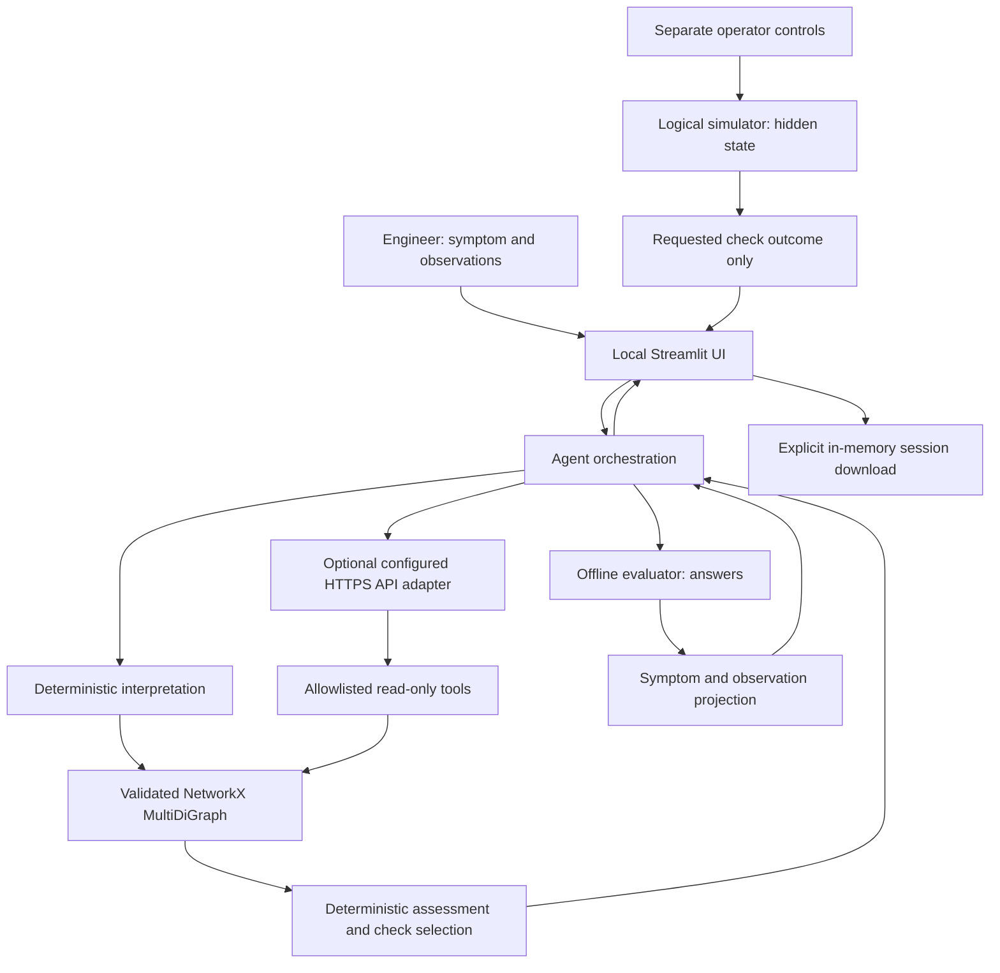

# Architecture

Figure 1 of the scope is retained as the conceptual boundary: engineer → Python agent →
graph tools → ECFKG → evidence-based outputs. The six graph layers are present. The
prototype implements a subset of Figure 2: host/test software, controller/chassis,
supply, switching, DMM, fixture/leads and opaque load. Physical connections, functional
dependencies and conditional failure mechanisms use different edge types.

## Runtime data flow

`KnowledgeGraph` resolves `data/workspace/current.json` to an immutable published graph/source
snapshot when the editor workspace exists; otherwise it loads the preserved `data/runtime/`
seed files. Explicit fixture directories remain supported. It validates the selected data,
constructs a frozen MultiDiGraph and computes a data hash. The source loader checks local
references and HTTPS syntax; it does not fetch URLs at runtime. Public content in
`data/review/` cannot enter retrieval by accident.

`Agent.run(symptom, observations)` accepts no scenario ID, expected answer or simulator
object. Baseline interpretation matches declared aliases. LLM interpretation first invokes
bounded tools and then emits validated symptom/component IDs. Unsupported inputs abstain.
The scorer retrieves conditional rules for those symptoms, compares categorical evidence,
returns at most three candidates and selects an unresolved check using all tied candidates.

Only the UI owns `Simulator`. It maintains a private state dictionary, chooses the report
from explicit state predicates, and returns one requested observation. It does not use
scenario names in diagnostic logic. Python privacy is an architectural separation, not a
security sandbox against a developer with process access. The LLM has no Python or file API.

`evaluate.py` is an offline consumer. It holds answer keys and sends only symptom text
and incrementally available observations to `Agent`. Evaluation IDs and expected faults
never enter runtime retrieval or model messages. The single development case is explicitly
designated and stored in the scenario layer, separate from evaluation.

## API model boundary

The interchangeable `ModelAdapter` protocol exposes `chat`. The active
`OpenAICompatibleAdapter` checks HTTPS `/models` and uses `/responses` for OpenAI or
`/chat/completions` for other compatible providers, with an explicit protocol override and Bearer
authentication. Keys are held separately from prompts and exported configuration. Tool-call
IDs correlate returned evidence with the provider's calls. The adapter disables HTTP proxies
from the environment and redirects, and normalizes tool arguments before local validation.
Responses uses `store: false` and replays reasoning and function-call items within each
tool loop; that internal context is not exported. Safe, fixed error messages distinguish
HTTP authentication, model access, quota and request errors without exposing provider text.
The configured provider receives symptoms, observations and relevant evidence. This API
boundary is an explicit user-requested revision of the original local-only plan. The previous
Ollama implementation is retained for future work but not selectable in the UI or CLI.

Six tools expose entity search, candidate retrieval, fault evidence, bounded dependencies,
diagnostic checks and source metadata. Extra arguments, unknown IDs and tools are rejected.
Limits: 2,000 symptom characters; 40 observations; six tool calls; seven interpretation
messages plus one evidence-selection request; depth four; 24 dependency paths; 24,000
characters per tool result; 256 KiB per HTTP response. HTTP requests have connection/read
timeouts and a 120-second orchestration deadline checked before each model call. A slow
chunk may run until its read timeout, so the deadline is not a process-level hard kill.

The complete graph is never serialized into the prompt. Only a short system instruction,
user data and bounded retrieval results are sent. Prompt hashes, settings, model metadata,
tool inputs/results and elapsed times are exported. Free-form model text is not displayed.
The final structured output must preserve candidate order/check choice and cite supplied
evidence; the UI renders stored facts. This limits hallucinated technical claims at the
cost of constrained model explanations. Semantic interpretation still needs human review.

## Persistence and deployment

The React Flow editor is a bidirectional Streamlit v2 component. It sends discrete selection,
connection/reconnection and layout events; `GraphService` owns typed CRUD, draft persistence,
validation, case comparison and local-review publication. Immutable revisions hold graph and
source metadata together; an atomic hash-checked pointer selects the active version. Drafts
never enter ordinary model retrieval. Separate layout files do not change graph meaning.
Publication rebuilds the graph on the next load; active sessions pin their original graph.
See `editor-guide.md` for revision history, backups, stale-edit protection and rollback.

The app UI binds to 127.0.0.1; API inference leaves the machine in API-assisted mode.
Sessions live in Streamlit memory and reset on server restart.
Downloads are explicit; there are no automatic user logs or remote logging. The agent has
read-only graph tools; trusted graph changes require the editor's validation and local review.
Streamlit usage telemetry is disabled. Evaluation exports contain only committed synthetic
test inputs by default. No authentication service or shared hosting is included.

